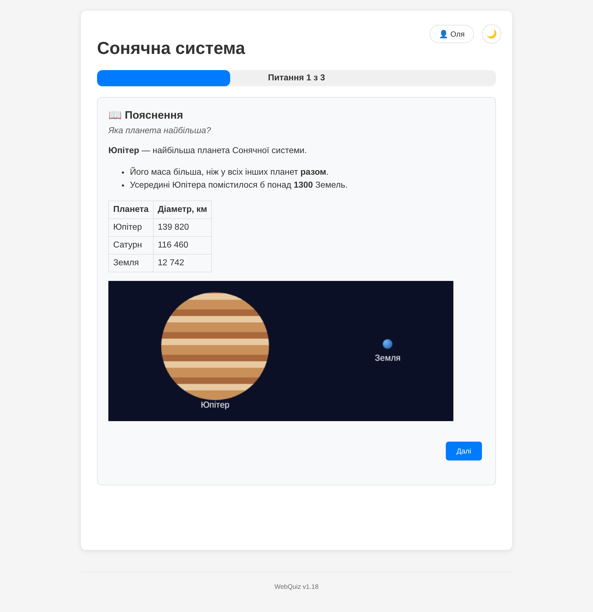
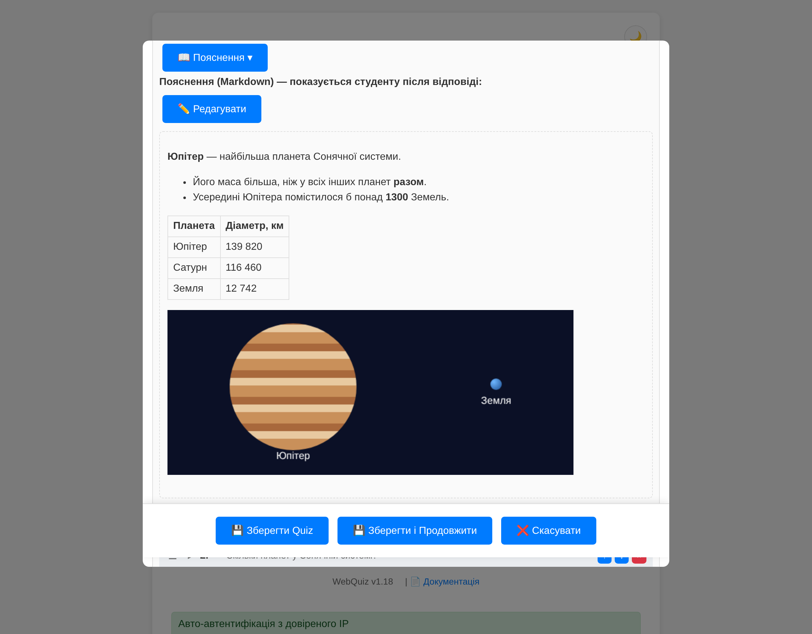
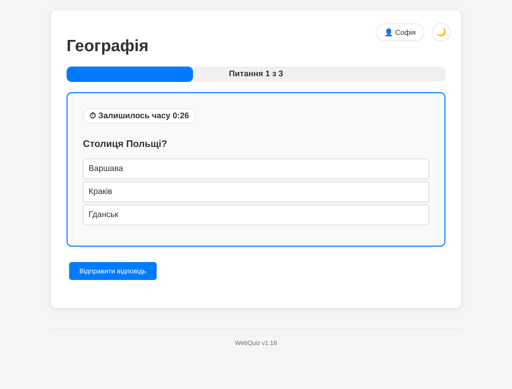
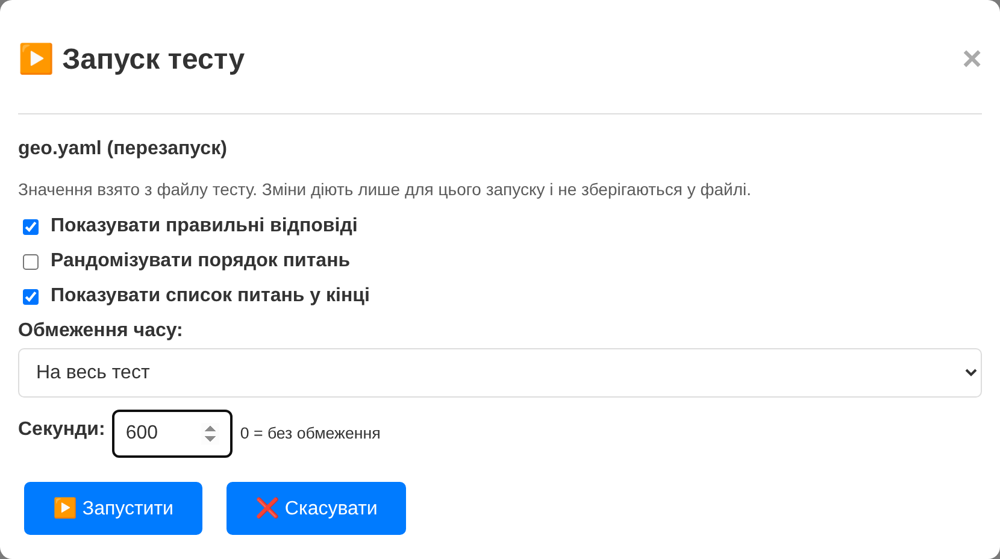
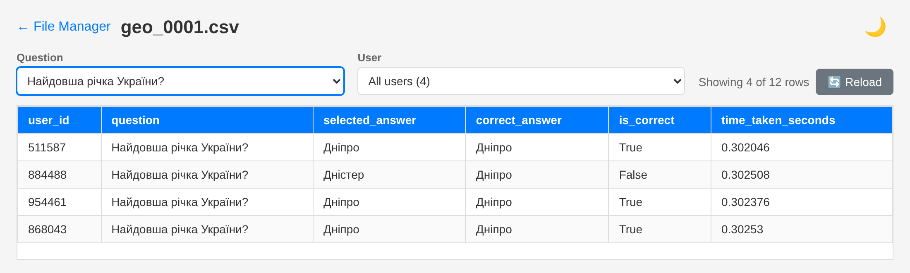

## ✨ What's New

### 1. 📖 Explanations after the answer

A question can now have an **explanation**: a short text the student reads right after answering, to remember the right answer. It is written in **Markdown**: bold text, lists, tables, links and images from `quizzes/imgs/`.

- After the answer, **"Продовжити"** (Continue) opens the explanation as its own step, and **"Далі"** (Next) opens the next question.
- Turn it on with `show_explanation: true`. Explanations are shown only together with correct answers (`show_right_answer: true`).
- In the quiz editor, each question has an **Explanation** field with an image button and a **Preview** button.





### 2. ⏱ Time limits, and settings chosen when you start a quiz

**Time limits.** A quiz can limit time **per question** (a default for every question, and each question may set its own) or for the **whole quiz**.

- **Countdown:** students see a timer that turns red in the last 10 seconds.
- **The clock:** a question's clock starts when the student's page shows it. Waiting for approval does not count.
- **Late answers:** an answer that arrives up to 5 seconds late still counts. A question with no answer in time is stored as **timed out**: an empty answer in the CSV, and ⏱ in live stats.

```yaml
time_limit:
  per_question: 60   # or: whole_quiz: 900
```

**Start settings.** When you start a quiz in the admin panel, a pop-up shows its settings:

- show correct answers;
- show answers after everyone finishes;
- random order;
- the question list at the end;
- explanations;
- the time limit.

The quiz file gives the default values. Your changes apply to **this run only** and are never written to the file.





### 3. 📊 CSV tables: filters and a new window

The CSV table in the file manager can be **filtered by question and by student**, and it shows how many rows are left.

- **Reload:** a "Reload" button reads the file again while the quiz runs.
- **New window:** the table can be opened in a new browser window. The filters stay in the page address, so a refresh or a bookmark keeps them.
- **Wrapping:** long text wraps, so all the columns fit on the screen.



### 4. 🔒 Quizzes from private archives

A downloadable quiz archive in the config can now carry an access token, so quizzes can come from a **private GitHub repository**:

```yaml
quizzes:
  - name: "Physics"
    download_path: "https://api.github.com/repos/OWNER/REPO/zipball/main"
    folder: "physics"
    auth_header_token: "github_pat_..."
```

- **How the token is sent:** in the `Authorization` header, and only over https.
- **Where it can go:** only to the address written in the config. The download request from the admin panel cannot redirect it.
- **The folder name:** GitHub wraps the archive in a folder whose name changes with every commit. The server finds your `folder` inside it.

